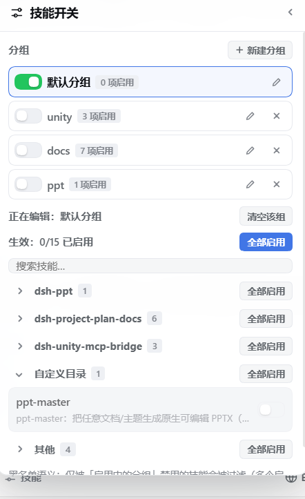
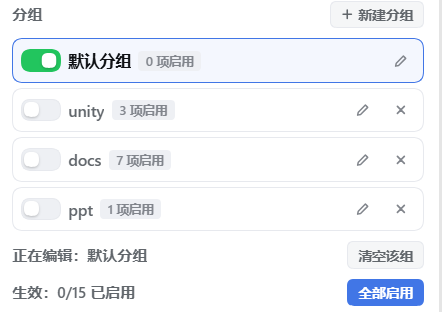

# dsh-skill-toggles

DeepSeek Harness 技能开关插件：**白名单语义 + 分组**——每个分组只负责自己启用的技能，永不禁用其它分组的技能；生效集合 = 所有"启用中分组"启用集合的**并集**（启用更多分组只会增加可用技能，两个分组不会互相冲突导致全部失效；所有分组都停用则全部技能不可用）。内置默认分组初始为"通配启用全部"，所以全新安装、状态文件缺失或损坏都等于"全部启用"，不会首次启动就"全部消失"；另有一个**初始停用**的「官方内置」分组，成员由当前目录自动判定（随安装包发布的技能），可一键整组启停。



## 安装

- **插件市场**：在 dshmarket 中搜索 `dsh-skill-toggles`，一键安装；
- **npm**：
  ```
  dsh plugin --profile desktop add dsh-skill-toggles
  ```
- **本地源码**：
  ```
  dsh plugin --profile desktop add file:<本仓库绝对路径>
  ```

安装后重启 DSH（浏览器半重新加载页面即可）。卸载：`dsh plugin --profile desktop remove dsh-skill-toggles`（`postuninstall` 自动删除状态目录 `<DSH_HOME>/dsh-skill-toggles/`）。

## 使用



1. **打开面板**：聊天输入框工具条的「技能」按钮 → 左侧悬浮面板。
2. **分组**：内置默认分组（初始通配启用全部、可编辑、不可删除）与内置**「官方内置」分组**（成员 = 随 DSH 安装包发布的技能，如官方 Office 套件 `office*`、`diagnose-windows-sandbox-acl`；**初始停用**，所以升级不会改变任何现有开关；激活它=一键启用全部自带技能，组内可逐个例外）；可新建/重命名/删除自定义分组——新建分组初始为**空白名单**（启用它不会带来任何技能，直到你在组内启用技能），也可在新建行点亮「成员＝自带技能」建一个**按来源自动判定成员**的分组；每组有自己的启用集合与启用开关，切换启用状态即整组加入/退出并集。
3. **技能列表**：每行开关作用于当前选中分组（对默认分组而言"禁用"= 记为例外）；支持搜索、按**来源分节**（插件包 / 用户 / 项目 / 自定义 / 其他，可折叠）与每节"全部禁用/全部启用"。技能被其它启用分组救活时显示"被「××」启用"徽标；选中分组自身停用时显示"本组未启用"。
4. **目录同步**：插件安装/卸载、bundle 启停、手改技能文件都会让宿主广播目录变更，面板与输入框 `/` 菜单**自动刷新**（无需关面板或刷新页面）；面板标题栏也有刷新按钮可强制重读。分组行的"启用 N 个"按当前真实目录计算，分组里残留的已卸载技能名不会把数字算错。
5. **Agent 工具**：`skill_toggles_list / disable / enable / enable_all / disable_all / source_set / group_create / group_delete / group_set_active`（均带可选 `group` 参数，缺省为默认分组；`group_create` 可带 `scope:"builtin"` 建自带技能组，`list` 的行带 `builtin` 标记、分组带 `scope`）。
6. **改动生效时机**：

   | 路径 | 生效时机 |
   |---|---|
   | 输入框 `/` 技能菜单 | 下一次打开菜单（亚秒级） |
   | 模型 `<available_skills>` 目录 | 下一条消息（宿主"持久投影"机制，任何插件都如此） |
   | `skill` 工具 | 立即拒绝被禁用的技能 |

只管 skills，不做 MCP 开关。
