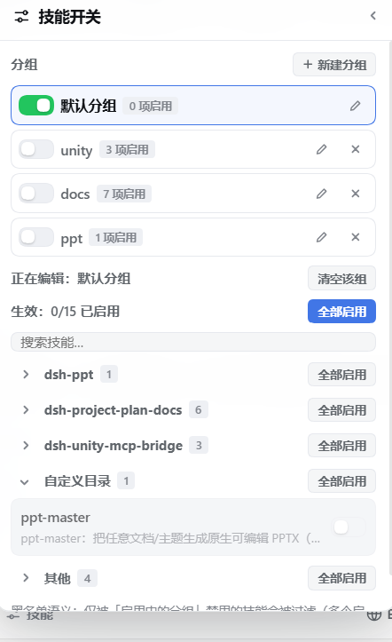
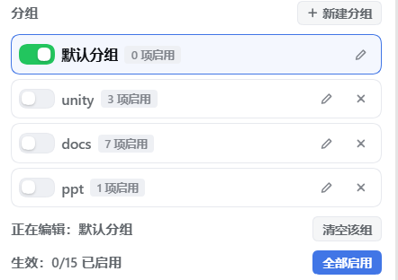

# dsh-skill-toggles

DeepSeek Harness 技能开关插件：**黑名单语义 + 分组**——所有技能默认可用，只有被"启用中的分组"显式禁用的才被过滤（生效黑名单 = 启用分组黑名单的并集）。全新安装、状态文件缺失或损坏都等于"全部启用"，永不出现"装上即全消失"。



## 安装

- **插件市场**：在 dshmarket 中搜索 `dsh-skill-toggles`，一键安装；
- **npm**：
  ```
  dsh plugin --profile desktop add dsh-skill-toggles
  ```
- **本地源码**：
  ```
  dsh plugin --profile desktop add file:<本仓库绝对路径>
  ```

安装后重启 DSH（浏览器半重新加载页面即可）。卸载：`dsh plugin --profile desktop remove dsh-skill-toggles`（`postuninstall` 自动删除状态目录 `<DSH_HOME>/dsh-skill-toggles/`）。

## 使用



1. **打开面板**：聊天输入框工具条的「技能」按钮 → 左侧悬浮面板。
2. **分组**：内置默认分组（初始全开、可编辑、不可删除）；可新建/重命名/删除自定义分组，每组有自己的黑名单与启用开关——切换启用状态即整组生效/失效。
3. **技能列表**：每行开关作用于当前选中分组；支持搜索、按**来源分节**（插件包 / 用户 / 项目 / 自定义 / 其他，可折叠）与每节"全部禁用/全部启用"。技能被其它启用分组禁用时显示"被「××」禁用"徽标。
4. **Agent 工具**：`skill_toggles_list / disable / enable / enable_all / disable_all / source_set / group_create / group_delete / group_set_active`（均带可选 `group` 参数，缺省为默认分组）。
5. **改动生效时机**：

   | 路径 | 生效时机 |
   |---|---|
   | 输入框 `/` 技能菜单 | 下一次打开菜单（亚秒级） |
   | 模型 `<available_skills>` 目录 | 下一条消息（宿主"持久投影"机制，任何插件都如此） |
   | `skill` 工具 | 立即拒绝被禁用的技能 |

只管 skills，不做 MCP 开关。

## 已知限制

- Agent 未激活的冷会话由 preset 常驻 scope 供数，其 `/` 菜单可能仍显示已禁用技能，直到会话被激活（模型目录与 `skill` 工具不受影响）。
- 与旧插件 `dsh-skills-mcp-group-manager` **互斥**（两个影子 provider 叠加语义不可控），启动时检测到会打警告。
- 重装/升级**已安装** bundle 后，宿主半需要重启进程才换代码（Node 模块缓存）；浏览器半无此问题。

## 实现要点（维护者）

- 状态（v2）：`<DSH_HOME>/dsh-skill-toggles/state.json`，形如 `{ version:2, groups:[{id,name,disabled[]}], activeGroups[] }`；原子写；损坏回退为"全部启用"；v1 扁平文档加载时自动迁移进默认分组。
- 过滤机制：per-agent 影子 skill provider（`skill-toggles-filter`，注册在 agent 层）。`list()` 只发射"生效黑名单 ∧ 真实存在"的条目，invocation 改写为 `{modelInvocable:false, userInvocable:false}`，`rank:0` 在同层内直接胜出（文件系统根 rank 100..500）；启用的技能不重发，保留原 provider 的 `path` 预览与正文加载。
- 变更后 `control.invalidate()` 清空 skill registry 的 collect 缓存，再对每个活动会话 `emit('agent-preset/selected')` 使浏览器半目录缓存失效。
- 宿主半 `apply()` 保持同步（Cordis 对 prototype-bearing 函数的处理决定，异步 apply 会导致进程崩溃）。

## 开发

```
node test/state.test.mjs   # 纯逻辑 + 存储往返测试
```

```
dsh-skill-toggles/
├── lib/index.js        宿主半（影子 provider、RPC、9 个工具、事件广播）
├── lib/client.js       浏览器半（输入框按钮 + 分组管理悬浮面板）
├── lib/state.js        纯状态逻辑（分组黑名单语义 + v1 迁移，单测覆盖）
├── lib/store.js        原子写状态存储
├── scripts/cleanup.mjs postuninstall 清理
├── cordis.patch.yml    安装到 profile 的配置补丁片段
└── test/state.test.mjs
```
